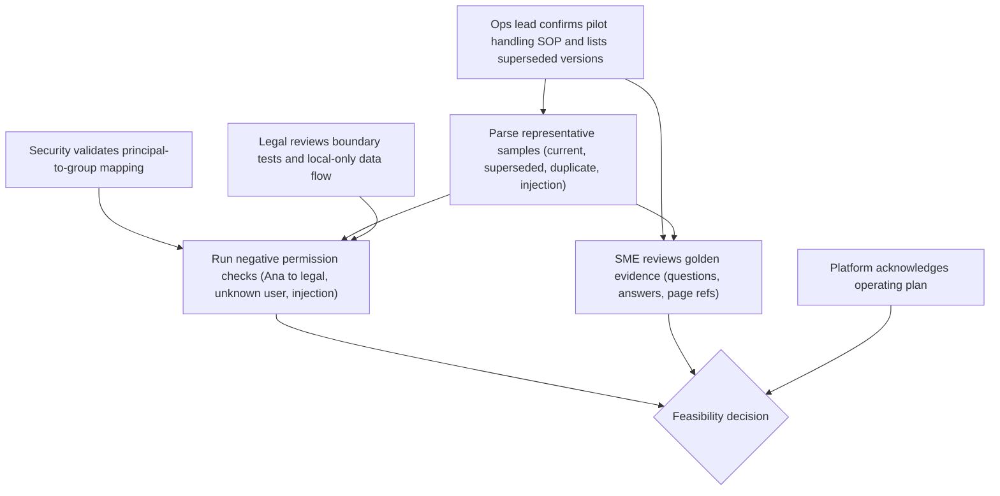

# Ask Halyard decomposition memo

**Sources:** HF-BRIEF-01 · HF-INT-01 · [data-inventory.md](data-inventory.md) · [discovery-question-log.md](discovery-question-log.md)
**Labels:** [Fact] supplied fact · [Claim] interview claim · [Assumption] · [Decision] · [Planned] · [Validate] requires customer validation

## Decision requested

Approve a **timeboxed feasibility spike** for one ops-policy workflow: the temperature-sensitive handling SOP lookup. This is approval to run experiments, not a delivery commitment.

## Evidence and uncertainties

**What we know**
- [Claim] Staff ask policy questions "several" times a day and interrupt colleagues to find the current version (HF-INT-01, Priya).
- [Claim] Tom can confirm the current handling SOP; other owners are not named (HF-INT-01).
- [Fact] Lab ACL: sales reads `sales/` and `ops/`; legal reads `legal/` and `finance/` (acl.json).
- [Claim] Hosted transfer is not approved; any permission leak stops release (HF-INT-01, Lena).

**Still unvalidated**
- [Validate] Which SOP version is approved, and whether its page text extracts reliably.
- [Validate] Production identity and group mapping (DQ Q3).
- [Validate] Retention and logging rules (DQ Q5).
- [Validate] Baseline lookup time. The fifteen-minute figure is an untimed estimate.

## Options

| Option | Evidence availability | Safety | Integration effort | Operational load | Measurable value | Uncertain because |
|---|---|---|---|---|---|---|
| Permission-aware retrieval | 2 | 2 | 2 | 2 | 3 | SOP authority and identity mapping are not validated |
| Search and ownership clean-up | 3 | 3 | 3 | 3 | 2 | We don't know whether time is lost finding the document or reading it |
| Ticket summariser tuning | 1 | 1 | 1 | 1 | 1 | Ticket resolutions, labels, personal data and retention are not profiled; tickets are not policy |

*Higher is better: 3 = strong, 1 = weak. For effort and load, 3 means low effort or load.*

**Non-AI finding:** If the baseline shows that once owners mark the current SOP, existing search finds the right page in under a minute, we recommend source clean-up alone and no assistant.

**Why retrieval over tuning:** policy changes, and retrieval from approved sources updates answers when the document updates. Fine-tuning changes style or behaviour; it neither keeps the model current nor grants permission to read files.

## Recommended thin slice

Read-only lookup of the temperature-sensitive handling policy from the one SOP that Tom confirms. Answers cite the page; when evidence is missing, the assistant says so and refers the user to the owner. Local-first model only. Synthetic lab principals only until security validates identity. Excluded: rate cards, legal and finance content, tickets, shipment changes, MCP server.

## Work breakdown

Branches run in parallel, but **good parsing can't compensate for failed permission checks**. The decision waits for D.

## Dependencies and owners

| # | Work package | Responsible | Accountable (approves) | Exit criterion |
|---|---|---|---|---|
| WP1 | Confirm pilot source | FDE prepares candidates | Ops lead (Tom) | Written confirmation of the current handling SOP and a list of superseded versions |
| WP2 | Parsing spike | FDE | FDE (technical finding only) | Every sample in the inventory has a recorded verdict; approved SOP page text is correct or flagged as failed |
| WP3 | Principal and ACL mapping | Customer security | Customer security | Mapping for the five lab principals documented; unknown principal returns nothing |
| WP4 | Negative permission checks | FDE | Legal lead (Lena) reviews | Zero leaks, including titles and existence; injection text changes nothing |
| WP5 | Golden evidence | Priya and Tom (SMEs) | Ops lead | Initial set of pilot questions with approved answers and page references, reviewed |
| WP6 | Legal data-flow review | FDE drafts diagram | Legal lead | Local-only flow and logging approved, or "not approved" recorded |
| WP7 | Operating plan | FDE drafts plan | Platform team lead (to be named) | Written acknowledgement, or "not agreed" recorded |
| WP8 | Feasibility decision | FDE presents evidence | Sponsor | Go, narrow or stop, recorded with evidence |

**Capability is not approval.** That the pipeline can read a file does not authorise its use. Only the accountable owner's approval does.

### If policy authority is unavailable

If Tom (or a delegate he names) can't confirm the current SOP within the timebox:
- WP1 is recorded as **"approval pending"**, not assumed. No version is treated as approved because of its filename, date or folder.
- The spike continues only on work that doesn't need approval: parsing samples, permission checks on synthetic data, and drafting evaluation questions marked "unreviewed".
- The sponsor is told in writing that the feasibility decision moves until authority is confirmed, and is asked to name a delegate.
- Nothing is presented as approved policy, in a demo or anywhere else.

## Stop and continue rules
### Blockers and risks

**Blockers** prevent the next release decision now. A high option score can't outweigh one.

| Blocker | Why it blocks | Owner | Cleared when |
|---|---|---|---|
| No owner has confirmed the approved handling SOP | No approved source means no pilot | Ops lead (Tom) | WP1 exit criterion met |
| Production identity and group mapping not validated | Permission filtering can't be proven | Customer security | WP3 exit criterion met |
| Legal hasn't reviewed the access boundary or data flow | Any leak or unapproved transfer stops release | Legal lead (Lena) | WP4 and WP6 reviewed |

**Risks** might happen. Each has a likelihood, impact, mitigation and a trigger for reconsidering.

| Risk | Likelihood | Impact | Mitigation | Trigger to reconsider |
|---|---|---|---|---|
| SOP page text extracts badly | Medium | High: no page citations | 2–4 day parsing spike; manual review fallback | Spike ends without correct page text |
| Superseded copies served as current | Medium | High: outdated policy | Index only the owner-confirmed version; superseded sample test | Superseded sample appears in any answer |
| Prompt injection in incident PDFs | High (known sample) | High: possible leak | Treat document text as data; exclude incidents from policy answers | Injection text changes any output |
| SMEs unavailable for golden evidence | Medium | Medium: decision delayed | Book SME time early; small first set | No review within a week of request |
| Platform team won't operate the service | Medium | High for production, low for pilot | Draft the operating plan early | "Not agreed" recorded at WP7 |

**Stop if:**
- any permission leak occurs, including titles, snippets or existence;
- injection text changes behaviour or access;
- any data would leave the approved local environment;
- no owner confirms an approved SOP version within the timebox.

**Narrow if:** the approved SOP's page text can't be extracted. Pause the assistant and propose source clean-up or a manually reviewed version.

**Continue only if:** WP1, WP3 and WP4 meet their exit criteria, and WP5 has SME-reviewed evidence.

## Estimate and next decision

| Item | Estimate | Assumptions | What would make it larger |
|---|---|---|---|
| Parsing spike (WP2) | 2–4 days (timebox) | SOPs are text PDFs, not scans | Scanned PDFs needing OCR; many formats |
| Permission checks (WP4) | 2–3 days after mapping | Folder-level ACLs are sufficient | Per-file ACLs; group data inconsistent |
| Golden evidence (WP5) | 1–2 days of SME time | Tom and Priya are available | SMEs unavailable; disagreement on the answers |
| **Elapsed to decision** | **2–4 weeks** | Approvals arrive within a week of request | Waiting for security, legal or owners usually dominates engineering time |

**Next decision:** feasibility review, proposed for 18 Dec 2026 (a planning assumption, not an agreed date).

## Friday demo decision

**Situation:** the approved SOP has no reliable page text, the source owner is unavailable, and the sponsor still wants Friday's demo.

**What I would show:**
1. **The pilot workflow on synthetic lab data**, labelled on screen: *"Synthetic data – not a live integration, not approved policy."*
2. **Safe behaviours that don't depend on the real SOP:** Ana asking for legal content gets nothing; an unknown user gets nothing; a question without evidence gets "I can't answer from the accessible sources", with a referral to the owner.
3. **The finding itself:** the approved SOP's page text can't yet be extracted reliably. Show the parse result and propose the next step (OCR spike or a manually reviewed excerpt once Tom confirms it).

**What I would not show:** answers presented as the approved current policy, or a "live" integration. Without the owner's confirmation there is no approved source, and I won't invent one to meet a date.